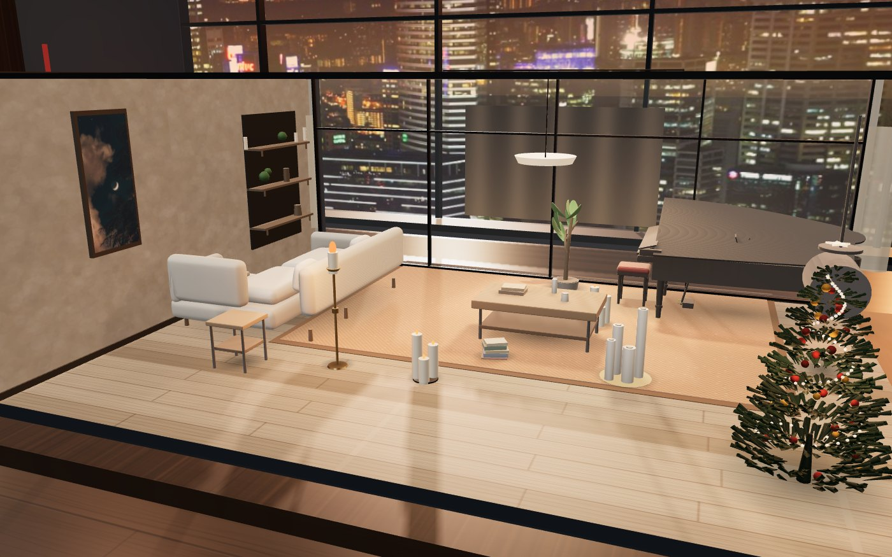
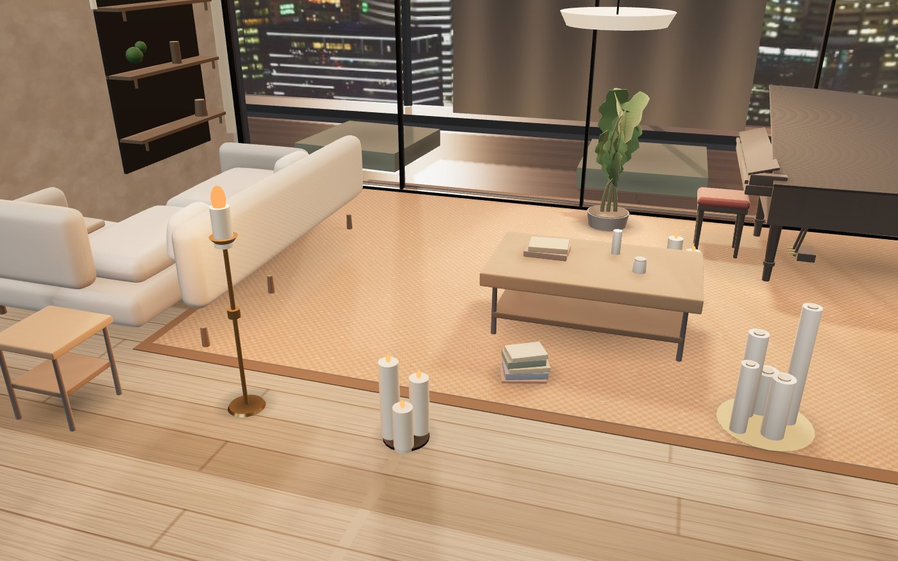
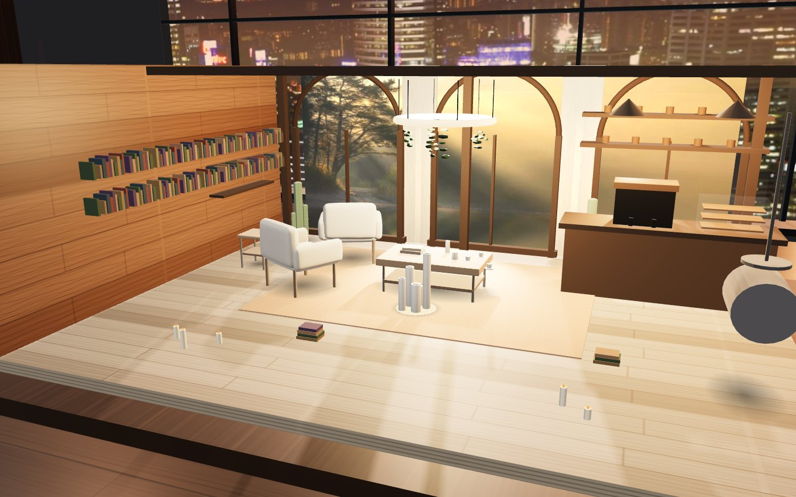

# 房间情绪板

**一间剖开的房间。把材质拖到墙上，把家具挪来挪去，拉一拉太阳。**



<p>
<code>四个房间</code> · <code>零第三方运行时依赖</code> · <code>双击即用</code> · <code>模型全部自制</code>
</p>

---

## 这是什么

做室内设计的时候，最难说服人的一件事是**“这个空间会变成什么样”**。
色卡和样板只能告诉你某一种材料的颜色，告诉不了你它在下午四点的光里、
和另外三种材料放在一起、被一盏台灯擦过边缘之后，是什么感觉。

这个项目想解决的就是这一步。

它把一间完整的房子**从中间切开**，摆在一张模型台上。四个房间都是真的
——墙有厚度，窗有窗框，床有床腿，钢琴掀开的琴盖下面是真的琴弦。
你可以把镜头转到任何一个角度，凑近去看一条门缝是怎么收的。

然后你可以开始动手：把木样本拖到地板上，把织物拖到沙发上，
把沙发挪到窗边，再把太阳从下午三点拉到黄昏。房间右上角有三个数字——
**暖、亮、静**——它们会跟着你的每一个动作重新算。

不是为了精确，是为了让你在三十秒内感觉到“偏了”。

---

## 目录

- [四个房间](#四个房间)
  - [暖光客厅 · 18:36](#暖光客厅--1836)
  - [咖啡小馆 · 17:24](#咖啡小馆--1724)
  - [居家主卧 · 09:24](#居家主卧--0924)
  - [夜景公寓 · 21:12](#夜景公寓--2112)
- [怎么玩](#怎么玩)
- [三个读数是怎么算的](#三个读数是怎么算的)
- [跑起来](#跑起来)
- [怎么做的](#怎么做的)
- [项目结构](#项目结构)

---

## 四个房间

四个房间不是四张皮，是四种完全不同的空间类型：挑高客厅、街边小店、
住在里面的主卧、以及一间只剩自己的公寓。切换的时候，窗外的天色、
屋里的光、家具的初始布置全部跟着换。

<table>
<tr>
<td width="50%"></td>
<td width="50%"></td>
</tr>
<tr>
<td><sub>全景：模型台、落地窗、窗外的黄昏城市</sub></td>
<td><sub>近景：弧形沙发、茶几、地毯的编织纹理</sub></td>
</tr>
</table>

### 暖光客厅 · 18:36

黄昏七点差一刻。太阳压得很低，光从整面落地窗斜切进来，在木地板上
铺开一片橘色，把地毯烤成蜜色。弧形沙发靠着左墙，三角钢琴正对着窗，
地上散着几支点着的蜡烛——那种“刚搬进来、还没收拾完，但已经坐下了”的状态。

这个房间的层高被刻意拉高了。高窗、长垂的窗帘、悬在半空的球形吊灯，
都是为了让光有地方落下来。**想看木头的纹理差异，从这个房间开始**——
暖光会把不同木种的红黄比例全部放大，换成冷光就看不出来了。

> 小贴士：把太阳从 18:36 往前拉到 16:00，同一间屋子会从“暖”变成“清亮”，
> 天花板和墙面的关系会完全不一样。

---

<table>
<tr>
<td width="50%"></td>
<td width="50%"></td>
</tr>
<tr>
<td><sub>全景：拱窗、吧台、藤椅，斜光在地板上拉出长影</sub></td>
<td><sub>近景：吧台台面、高脚凳、桌上的杯子</sub></td>
</tr>
</table>

### 咖啡小馆 · 17:24

午后偏晚，斜光穿过拱窗，在木地板上拉出一排长影。木梁、木柱、
深色吧台，靠窗一排高脚凳——那种开了七八年、家具被磨出包浆的小店。

这个房间不大，是四个里面密度最高的。**想试家具密度，来这里**：
往里面塞第五把椅子的时候，“静”读数会明显往下掉，而“暖”几乎不动
——因为挤是挤，暖是暖，两件事不该混在一起。

> 小贴士：拱窗的窗台很窄，别试图把高柜推到窗边——家具进不去的判定
> 是按“整体包围盒 + 已占空间”算的，不是点碰撞。

---

<table>
<tr>
<td width="50%"></td>
<td width="50%"></td>
</tr>
<tr>
<td><sub>全景：床、钢琴、窗边串灯、格子毯</sub></td>
<td><sub>近景：钢琴琴体、掀开的琴盖、琴弦与车木琴腿</sub></td>
</tr>
</table>

### 居家主卧 · 09:24

早上九点半，光还偏冷，从窗口斜进来是浅浅一层。床靠左墙，
被子铺得很整；三角钢琴占掉半间屋子，靠墙那侧还留着一把琴凳；
窗上垂着一串小灯，白天也亮着；地上铺一张格子毯。

主卧里那架钢琴是单独做的模型：梨形琴体、掀开的琴盖、分三段的琴弦区、
踏板架、三条车木锥形腿，**10 884 面**。凑近看，琴键是一颗一颗的。

> 小贴士：这个房间是唯一“家具就是主角”的——床和钢琴占掉了大半个地面，
> 剩下的空隙刚好够走路。想试试“东西多但不显挤”，这是个正例。

---

<table>
<tr>
<td width="50%"></td>
<td width="50%"></td>
</tr>
<tr>
<td><sub>全景：整面玻璃幕墙、成片的写字楼灯光</sub></td>
<td><sub>近景：多层床品、床头柜台灯、窗边书桌</sub></td>
</tr>
</table>

### 夜景公寓 · 21:12

九点一刻。整面玻璃幕墙，窗外是成片的写字楼——那种“楼比人多”的区域。
室内几乎不开主灯，只留几处暖光：床头的布罩台灯、衣柜底部的踢脚灯、
书桌上一台亮着的笔记本，屏幕的光落在桌面边缘。

床是四个房间里做得最细的一件：床架有横档，四腿是收分的锥形；
床垫分两层，床单铺满之后三边垂到地面；被子盖住五分之三，
靠脚那一端翻了一道边，露出内侧；床尾横压一条毯子，两头垂下来；
枕头两只，后面还斜塞了两个抱枕。

**想看清“布”和“盒子”的区别，看这张床**——每一条边都是软下去的，
没有一条直棱。

> 小贴士：这个房间的地面只有一张地毯，留白很多。想试“极少但很贵”的路线，
> 在这里摆两三件好东西，比摆满更有效。

---

## 怎么玩

四个动作，没有隐藏菜单。

### 一、换材质

底部样本栏按 **木 / 石 / 织物 / 涂料** 分成四类。按住任意一块，
拖到墙上、地上、或者家具上松手，那**一个面**就换材质。

判定是按“射线打中的那个面”算的——同一面墙的不同墙面可以贴不同的材，
不会整屋一起变。想还原，点样本栏右侧的重置。

### 二、搬家具

家具面板里选一件，按住拖进房间。松手时它会**自动避让**：
碰到墙会往回收，碰到别的家具会挪位置，实在放不下就不给放。

家具的包围盒是按真实尺寸算的（沙发 2.2 米、双人床 1.8 米），
所以小房间里塞大件会被挡住——这是故意的。

### 三、调时间

左上角的时间滑块控制太阳的**方位角**和**高度角**。
拖动的时候，四件事同时发生：

1. 窗外的天色从正午的亮蓝 → 黄昏的橙金 → 夜里的靛蓝，连续插值
2. 屋里的光斑形状跟着变长、变斜、变暖
3. 墙面和地板的反射色温跟着变
4. 三个读数一起重算

### 四、读情绪

右上角常驻三个数字。它们不是装饰，是每次操作后实时算出来的
（算法见下一节）。

---

## 三个读数是怎么算的

每个读数都是 **0–100** 的加权和，权重写在代码里，不是拍脑袋定的。

| 读数 | 主要由什么驱动 | 为什么 |
|---|---|---|
| **暖** | 光源色温、木材面积占比、灯光色、软装暖色比例 | 冷白光下再多的木头也不会暖 |
| **亮** | 开窗面积、墙面反射率、太阳高度角、深色材质占比 | 亮是“进光量 × 反射量”，不是把灯开大 |
| **静** | 家具密度、软装占比、色彩饱和度、对称度 | 东西越多越不静；颜色越纯越不静 |

三个数是**互相独立**的：把墙刷成深色，“亮”会掉但“暖”不动；
塞第五把椅子，“静”会掉但“暖”几乎不动。这样你才能分辨
“我现在想解决的是哪一个问题”。

---

## 跑起来

### 最快的方式

克隆仓库，**双击 `standalone.html`**。

不需要起服务器，不需要联网，不需要装任何东西。整个应用——四个房间的
几何、全部贴图、全部代码——都被内联进这一个 HTML 文件里。

### 看源码版

```bash
# 在 moodroom/ 目录起一个静态服务器（ES module 需要 HTTP 协议）
npx serve .
# 或者
python -m http.server 8080
```

然后打开 `http://localhost:8080`。`index.html` 是入口。

### 常见问题

**双击打开是空白？** 检查浏览器是否禁用了本地文件的脚本。
Chrome 需要在设置里允许，或者改用上面的服务器方式。

**画面卡？** 四个房间的面数在 1 万到 8 万之间。低端设备建议先在
“暖光客厅”里试，那个房间最轻。

**改动不生效？** 布局存在浏览器的 localStorage 里，换版本时会自动失效
（存储键里带版本号）。想手动清，浏览器控制台执行
`localStorage.clear()`。

---

## 怎么做的

### 渲染：Three.js，零第三方运行时依赖

整个项目**没有一个 npm 依赖**。Three.js 本身是 vendored 进来的单文件，
其余全部手写。

所有几何体的明暗**不靠实时阴影**，而是靠 Blender 烘好的顶点色和 AO。
代价是不能有动态光源投影，好处是在集成显卡上也能跑满 60 帧——
这个项目的目的是“看感觉”，不是“看渲染质量”。

### 建模：Blender 脚本化

所有模型都是 Python 脚本生成的（`blender/*.py`），没有手工拉的模型。
每个构件都是参数化的：改一个床宽，床架、床单、被子的宽度会一起变。

四个主要模型的面数：

| 模型 | 面数 | 说明 |
|---|---:|---|
| 三角钢琴 | 10 884 | 琴体、琴盖、琴弦、琴键、踏板架、车木腿 |
| 居家主卧 | 25 066 | 房间外壳 + 床 + 钢琴 + 串灯 + 家具 |
| 夜景公寓 | 84 582 | 房间外壳 + 多层床品 + 衣柜 + 书桌 + 灯具 |
| 家具库 | 14 件 | 沙发 / 床 / 桌 / 椅 / 柜 / 灯 / 植物 |

导出时会按目标面数减面（DP 减面），进页面的数据再小一圈——
低端设备上也能跑起来。

### 材质：没有一张外部贴图

木纹、石材、织物、涂料的全部纹理，都是运行时用 canvas **程序化生成**的。
所以整个项目能塞进一个 HTML 文件——没有任何一张图需要外链。

程序化材质的另一个好处是**尺度可控**：同一张木纹，铺地板和铺桌面时
密度自动换算，不会出现“桌面上的木纹比地板还大”这种穿帮。

### 窗外：三档调色的实拍城市

窗外的城市是从实拍夜景照片里取的，调出三档：**黄昏 / 白天 / 夜晚**。
按时钟连续插值，两档之间叠一层做交叉淡入，所以拖时间轴的时候
天色是渐变而不是跳变。

3D 场景里的建筑只是近景剪影，负责提供视差——真正的城市景观
是那三层贴图平面。

---

## 项目结构

```
moodroom/
├─ standalone.html          # 单文件版（双击即用）
├─ index.html               # 源码版入口
├─ app.js                   # 主程序：场景构建、交互、读数
├─ styles.css
├─ blender/                 # 建模脚本（Python）+ 打包脚本
│  ├─ build-piano.py
│  ├─ build-night-v4.py
│  ├─ build-forest-scene.py
│  └─ …
├─ docs/
│  ├─ shots/                # README 用的实拍图
│  └─ DEVLOG.md             # 开发记录（每个版本的改动因果）
└─ *-assets.js              # Blender 导出的几何数据（内联进单文件）
```

---

## 开发记录

做这个项目踩过的坑、每次改动的因果，都记在 [docs/DEVLOG.md](docs/DEVLOG.md)。

里面有几个花了很久才定位的问题，比如：

- **场景切换时旧房间不移除**——切过三次之后，三个房间的几何叠在一起同时渲染，
  表现为“雪林穿到别的房间窗外”
- **渲染循环每帧重设 `visible`**——一次性设的隐藏被下一帧冲掉，
  表现为“设了隐藏却还看得见”，查了四轮才找到
- **Blender 导出 VEC4 顶点色，打包器按 3 分量读**——整块几何变成彩虹色

---

<p align="center">
<sub>用 Claude Code + Sonnet 5 开发 · 模型全部自制 · 无第三方素材</sub>
</p>
