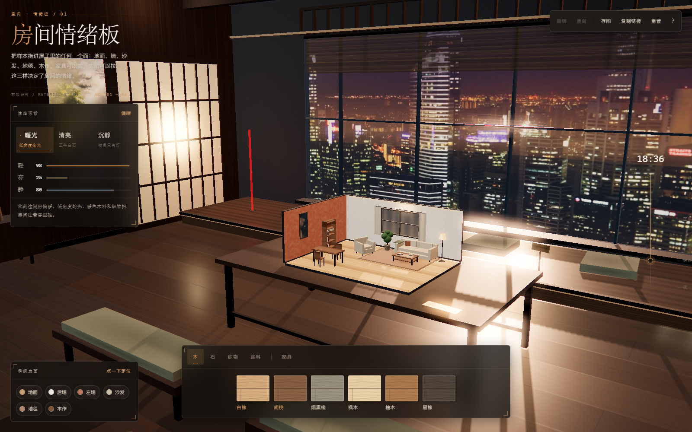

# 房间情绪板



一个剖开的房间：把木材、石材、织物、涂料的样本拖到任意一个面上，搬动家具，拉动太阳。
房间的"暖 / 亮 / 静"三个读数会跟着材料、光和布置实时变化。

**在线试玩**：克隆后双击 `standalone.html` 即可（无需服务器、无外部依赖）。

## 三档情绪（v5 重调暖光与清亮）

| 预设 | 时间 | 窗外 | 室内 |
|---|---|---|---|
| **暖光** | 18:36 | 黄昏版城市：紫靛天空 → 橙金地平线，楼体压暖褐 | 一盏从窗口斜射进来的暖光（`duskSpill`），冷补光同步调暖调弱 |
| **清亮** | 12:24 | **原照片调色**：亮蓝天 + 有重量的城市，保饱和、压高光、S 曲线找对比 | 天光涌进屋里（hemi 0.46 / env 0.58 / windowFill 1.05） |
| **沉静** | 22:12 | 原始夜景照片（本次未改动） | 只留几盏灯（本次未改动） |

### 一个根因，两处受害

**旧版只有"白天 / 夜里"两档贴图，且白天版是 `saturate(0.30)`。**
暖光(18.6) 与清亮(12.4) 的 `dayF` 都 > 0.5，双双落进"白天"分支，
共用同一张去饱和到接近黑白的图——所以窗外才"像要死"。
沉静(22.2) 走的是 night 分支，拿到原始夜景，所以只有它好看。

现在改成 `cityWeights(hour)` 连续权重驱动三档（night / dusk / day），
两档之间用**第二层平面交叉淡入**。实测 67 个采样点权重和恒为 1，
16:30 与 16:45 两张截图确认过渡是渐变而不是跳变。

### 黄昏凭什么"暖"

不是把夜景调亮就行。做了三件事：
1. `duskSpill` —— 一盏从窗口斜射进来的定向暖光，只在天光偏暖时点亮
2. `windowFill` / `rimCool` 在黄昏由冷蓝转暖橙，强度按 `duskWarmK` 衰减
   （它们原本 0.94 / 0.6，不处理会把暖光直接冲成灰）
3. hemi / groundColor 同步转琥珀

### 白天凭什么"透"

清亮的问题不只是暗，是**太阳高度角 66° 时几乎不进窗**（房间又换了深色木墙）。
所以白天的补光不能只靠太阳：
- `windowFill` 从 0.32 抬到 1.05（旧值白天比夜里还低，等于窗口更暗）
- `hemi` 0.28→0.46、`environmentIntensity` 0.30→0.58、`bounce` 0.24→0.42

### 白日版怎么从原照片调出来

要求是明确的：**就用那张照片，改色调**。所以不做结构重绘。

## 走过的错路（都记下来，避免再犯）

| 做法 | 出来的东西 |
|---|---|
| 提亮 + 去饱和 + 叠蓝天渐变 | 一块蓝矩形贴在夜空上，硬边 + 色阶断层 |
| 按天际线重绘楼群 | 一块块矩形，一眼假 |
| 只提暗部 + 去饱和 + 加雾 | 白皑皑一片，像下过雪的空城 |
| 只提亮整体 | 又回到满城灯火，读成夜里 |

前两条错在**动了结构**；后两条错在**把亮度当成"白天"**。

## 现在这条：保住对比，用天空说"白天"

`gradeDayFromPhoto()` 的六步：

| 步骤 | 参数 | 作用 |
|---|---|---|
| 软化 | `blur(1.3px)` | 窗灯点阵并成肌理；3.4px 会把整座城糊掉 |
| 影调 | `LIFT 0.175 + 0.86 × l^0.46` | 抬暗部，楼体有重量 |
| 高光滚降 | `>0.74` 再 `×0.48` | 灯不糊成白块 |
| 饱和度 | `0.86` | **这张照片的颜色是资产**，之前压到 0.12 就成了黑白照 |
| S 曲线 | `×1.24` | 找回中间调对比 |
| 天空 | 蓝灰渐变铺到 66% | **"白天"必须由天空说清楚**，靠整体提亮做不到 |

关键认知：
1. **不要用"整体亮度"表达白天**。把 LIFT 推高只会得到白皑皑一片；
   真正区分昼夜的是"天空比城市亮、且是冷的"。
2. **不要把饱和度压掉**。压掉之后即便亮度对了，也是一张死气沉沉的灰片。
3. **夜城的窗灯是硬约束**。试过按 12px 邻域检测并压灭窗灯，
   压得太狠整座城会变成雾；这张素材只能做成"天光刚起的清晨"，
   不可能做成正午——除非换素材。

## 光影修正（v5.5）

之前室内看起来"平"，根因是**太阳站在相机背后，光根本进不了窗**。
逐光源隔离实测：只开太阳时整间屋子几乎全黑。

| 问题 | 实测 | 修正 |
|---|---|---|---|
| 太阳方位角写反 | 12:24 太阳落在 z=+6.9，窗在 z=-4.9，方向相反 |
   z 改为 `-abs(cos(azim))·horiz·0.85`，太阳恒定在窗外 |
| 阴影相机 far 不够 | 太阳距目标约 21 m，far=20 把整间房裁掉，阴影直接消失 | far=60，范围 ±11 |
| 墙和天花不投影 | 单面墙 `castShadow` 未开、默认 shadowSide 是背面，光从墙里穿进来 |
   打开 castShadow + `shadowSide=DoubleSide` |
| 正午太阳太高 | 67° 时从窗顶进来只走 1.46 m 就落地，全落在窗外緑側台 |
   降到 34°，方位角偏置让光斜着扫进来 |
| 补光盖过直射 | 白天几盏补光把屋子洗得一样亮，看不出近窗亮、往里暗 |
   补光各收一档、直射抬到 3.10 |

修完后能看见阳光越过窗台落到桌面和模型内部，窗棂在緑側台上投出条状影。
三个预设逐一复查：沉静仍是夜景、暖光保留斜射暖光，都没被带坏。

阴影精度从 2048 提到 4096：范围 22 m 时 2048 只有 93 texel/m，窗框细边会糊。
放大检查过阴影边界——没有自阴影条纹，也没有物体与影脱开的缝。

**自测新增 `sunThroughWindow`**：在 8 / 12.4 / 17 / 22 四个时刻断言太阳都在窗外，
并检查阴影相机 far、范围、贴图尺寸与墙体投影。这类几何错误肉眼只觉得"有点平"，
用断言钉死才不会改时间时又退回去。

## 模型房间的挂画（v5.6）

桌上模型房间左墙那幅画，换成设计师给的月夜照片：深蓝夜空、月亮、云、蕨叶。

- 原图 484×1036，宽高比 0.467；原画框是横的 1.06×0.76
- 画框改成竖幅 0.71×1.52，画心 0.65×1.42，比例 0.458，误差 <2%
  —— 完整显示，不裁切、不拉伸
- 图片内联成 base64（93 KB），单文件依然可双击打开、无外部依赖
- 挂画在场景里只有几十像素，第一版看不清月亮，所以画框放大了一档
- 贴图加一点自发光（emissive 0x3a4a58 / 0.22），夜景时段也能读出来

自测新增 moonArt：断言图片内联、画心贴图确实是 484×1036、画框比例与图片吻合。
图片是异步加载的，src 写错会留一块空画布，所以也检查贴图画布尺寸。

## 房间里的四幅画（v5.6 – v5.9）

全部内联 base64，单文件版依旧零外部依赖。

| 位置 | 内容 | 原图 | 画框 / 画心 |
|---|---|---|---|
| 模型房间左墙（v5.6） | 月夜实拍：月牙、云、蕨叶 | 484×1036 | 0.65×1.42 |
| 主房间左墙挂轴（v5.9） | 晨雾林道：绿叶、光束、小路 | 487×1045 | 0.91×1.95 |
| 右墙横幅（v5.9） | 漓江渔舟：晚霞、山峰、倒影 | 1647×928 | 1.95×1.10 |
| 后墙壁龛（v5.9） | 浪人剪影：灰白天空、刀与鸟群 | 462×1048 | 0.77×1.74 |

三面墙的新画按各自原图宽高比改画框，误差 <3%，完整显示、不裁切、不拉伸。
右墙横幅第一版偏小，放大到 1.95×1.10 后渔舟与倒影才看得清。

通用贴图工厂 makeWallArt + wallArtMaterial：
- 图片异步加载，先用深色打底，src 写错不会留一块刺眼的空白
- emissiveMap 复用同一张贴图，发光的是画本身的颜色，
  不像固定暖褐色 emissive 那样把冷调/白天的画染黄

自测 wallArts 查四幅：图片内联、贴图画布尺寸、画框比例吻合，
三幅新画还额外要求 emissiveMap 与 map 是同一张贴图。

## 署名（v5 新增）

房间里有**两块黄铜铭牌**，都能点：

| 位置 | 内容 | 跳转 |
|---|---|---|
| 桌面右下角（平放，像家具落款铜牌） | `karlmoriaty` / interior moodboard · 2026 | https://github.com/karlmoriaty |
| 縁側台右端（带杆小立牌，像展厅作品标签） | `@karlmoriaty` / X · TWITTER | https://x.com/karlmoriaty |

悬停时铜面提亮、光标变手型，点击在新标签打开。位置不是估的——
用 `?probe=1` 暴露的探针把世界坐标投影到屏幕算出来：
第一版立牌放在 x=3.55 时投影到屏幕 x=1898（画面外），
x=2.15 会压到右侧时间轴面板，最终取 0.95 落在两只坐垫之间的空当。

自测新增 `signPlates`：校验两块牌都在场、链接正确、
**并且能在各自的屏幕投影位置被射线拾取到**（不能拿世界坐标冒充）。

## 房间内部（v4「和风 + 霓虹」）

装着模型台的那间大房间，按四张参考图（日式室内 + 赛博霓虹）重做构造：

| 构件 | 做法 | 为什么 |
|---|---|---|
| 地面 | 深色**抛光木地板**（程序化拼板 + 粗糙度贴图，roughness 0.42） | 参考图的地面是整间房的反光底 |
| 窗边 | **縁側抬高平台** 0.22 m，前沿深色收边 + 台沿灯槽 | 在"室内/窗外"之间加一层过渡 |
| 左墙 | 整面**障子**（半透纸 + 木格 + 背后柔光） | 夜里是最亮的一块"墙"，和室的识别符号 |
| 门 | **推拉障子门**（两扇 + 引手），不是平开门 | 和室没有平开门 |
| 墙面 | 竖向木纹**护墙板**，不是纯灰涂料 | 靠板缝与微弱反光读层次 |
| 天花 | 4 道**横向木梁**，留 0.5 m 边距"架在墙上" | 把 10 m 进深切出节奏 |
| 窗顶 | **竹帘**（簾）+ 卷轴，遮住窗景上缘 0.62 m | 不让人一眼望穿 |
| 窗上 | **欄間**竖向细格（26 根），白天透光、夜里暗剪影 | 和室的收口方式 |
| 霓虹 | 两根**红色竖霓虹管**（细管 + 底座 + 小范围点光） | 冷空间里唯一的高饱和色 |
| 家具 | 两张**贴地矮凳**（坐高 0.30）+ 浅绿坐垫、矮茶台、桌前一坪**榻榻米** | 贴地坐姿，房间才显高 |
| 挂画 | 竖长**挂轴**（水墨远山 + 绫边），不是方画 | 和室墙面不挂方画 |

### 四个踩过的坑（都是实测定位的）

1. **地面不能铺满榻榻米**。一开始铺了 5.6×4.0，把整片抛光地板盖死，地面立刻变哑光；
   参考图里草席只是局部小垫。现在只在桌前一坪 2.9×1.6。
2. **`roughnessMap` 与 `roughness` 是相乘关系**。贴图底色 0.23 × 材质 0.26 = 0.06，
   地板接近全镜面，吊灯在地面摊成一颗锐利圆球，看起来像"悬浮光球"穿帮。
   底色提到 0.78、材质 0.42，高光才摊成一片。
3. **霓虹要按相机几何摆**，不能按"哪里有墙"摆。相机在 (2.80, 2.46, 3.13)，
   水平半视角 31.5°；贴左墙 z=-0.55 时夹角 31.7°，**正好差 0.2° 出画**。
   挪到縁側台左端（z=-4.0）后夹角 14°，稳定入画。
4. **地板倒影不是高斯模糊**。各向同性模糊会把城市里某颗亮窗糊成圆球；
   真实地板反光是沿视线拖长的竖条。改成纵向运动模糊（同一张图沿 y 叠加 26 次，
   峰值摊平约 20 倍），并且只铺贴近窗的 2.6 m 一条带，不铺到房间中央。

工程约束：所有新构件都用程序化几何 + canvas 贴图，**不引入任何外部模型/贴图**
（`vendor` 里只有 three 核心，没有 GLTFLoader；单文件版还要能 `file://` 双击）。
程序化几何加上这些构造语言已经足够，用 Blender 出模型反而会破坏这两条约束。

## 设计定调（v3「Luxury / refined」）

**受众与目的**：设计师本人用的材料情绪板，屋子是画面唯一主角，UI 是压在暗场上的一层档案页。
**方向**：轻奢雅致 / 编辑式。一个清晰方向执行到底，不混搭极简与极繁。
**字体**：中文衬线展示字（宋体系）+ 中性无衬线正文 + 等宽数字；全部本地字体栈，
不联网、不阻塞首屏（单文件 `file://` 也要能看）。**不用 Inter / system-ui 做展示字**。
**配色**：暖近黑 `#0b0a09` 60% / 象牙白与暖灰 30% / 唯一强调色暖铜 `#d99a5b` 10%，
只给选中态、时间与关键数值。
**记忆点**：衬线大标题首字暖铜 + 版权条 `MATERIAL STUDY · NO.01` + 面板四角括号 + 时间轴细刻度尺。
**动效**：一次编排好的 6 组入场序列（错峰 90ms）、下划线扫过 / 背景擦除的 hover，
全部在 `prefers-reduced-motion` 下关闭。

### 电影级后处理（零第三方依赖）

vendor 里只有 three 核心，没有 `EffectComposer`。用 `WebGLRenderTarget` +
`ShaderMaterial` 手搭一条管线：**场景 → 亮部提取 → 两级分离高斯 → 合成**。
合成里做辉光、ACES 色调映射、色彩分级、暗角、色差、sRGB 编码、胶片颗粒。
`?nopost=1` 可关闭作 A/B 对照；`renderFrame()` 内 try/catch 失败自动回退直出，绝不黑屏。

三个必须记住的坑（都是实测踩出来的）：
1. **three 渲染到 RenderTarget 时会跳过 ACES**（`toneMapping = NoToneMapping`，输出线性空间），
   合成里必须自己补一遍 ACES，否则等于把线性 HDR 直接编码 → 整片洗白。已照搬 three 的
   `ACESFilmicToneMapping` 公式。
2. **RT 必须是 `HalfFloatType`**。8 位线性 RT 在暗部只有 2~3 个量化级，编码回 sRGB 后
   放大成紫蓝色带与噪斑。
3. **胶片颗粒必须放在 sRGB 编码之后**。线性空间 0.01 的抖动经 sRGB 曲线在暗部会被放大。
   另外亮部阈值取 1.0（线性 HDR），低于 0.6 会把整片窗的城市贴图当光源。

### UI 工程约束

- 所有 id / class 一个不改，25+ 条自测与全部交互接线保持原样。
- **入场动画绝不使用 `animation-fill-mode: both`**：动画若不推进（后台标签、虚拟时间、
  省电模式），元素会被锁在 `opacity:0`，整个界面空白。默认态必须始终可见。
- 抽屉与时间轴的定位依赖 `transform`，入场动画只做 `opacity`/`filter`，
  否则各响应式断点会错位。
- **时间轴必须保持竖向**：JS 用 `clientY` / `height` / `top` 驱动（`railFromY`、
  `#rail-fill` 的 height、`#rail-knob` 的 top），改成横向会直接失效。
- 装饰拱圆用 `mask-image` 只在中上部淡入，否则大圆侧边会在画面里露出一条笔直竖线。
- 自测断言 `postPipeline` 必须先调 `renderFrame()` 再检查 uniform，否则 RT 尚未绑定会误报。

**验收基线**：源码版 + 单文件版各 27 条自测全绿；夜/昼两档真实帧逐张看过；
`?nopost=1` A/B 对照确认辉光与层次提升真实；504×749（窄屏断点）/ 1600×1000 两档
DOM 几何实测所有元素 `opacity:1` 且在视口内；打包产物语法检查通过。

## 窗外城市（3.5 节）

**正对窗的主景是设计师指定的实拍夜景照片**（`city-night.jpg`，
1080×470）。三层圆柱（远 / 中 / 近）仍由 `cityCanvas()` 程序化生成，
只负责转视角时的视差；照片这一层才是「一眼看到的那座城」。

照片以 data URI 内联在 `city-photo.js`；`build-standalone.mjs` 会把该模块
一起打进单文件，所以 `standalone.html` 用 `file://` 双击打开也能显示，
不需要任何外部图片文件。`?selftest=1` 的 `cityPhoto` 断言会校验贴图尺寸、
UV 重映射、以及 data URI 确实内联（长度 > 100000），防止打包时漏掉图片。

- **夜景**：照片原图。`toneMapped:false` + 后处理只加辉光/暗角，不再叠假光斑。
- **白天**：从同一张照片派生（`brightness 1.62 / saturate 0.30 / contrast 0.90`
  + 冷蓝渐变），建筑轮廓逐像素一致。若白天换回程序化城市，拉时间轴会整座城突变。
- **取景**：相机透过窗只看到照片平面 `u≈0.235~0.710、v≈0.267~0.676`。
  四组 UV 实拍对比后定 `repeat(1.80, 2.163) / offset(-0.342, -0.520)`，
  能同时收进左侧楼群、中间弯曲条纹塔、右侧白色亮楼，且不拉伸变形。
  严格按可见区全宽映射会把右侧地标切在画面外。
- **叠加层**：`cityGlow`（城市反光）与 `bokehA/B/C`（虚焦光斑）原本是给程序化
  城市补光的，叠在实拍照片上会把它染成棕黄、并在某栋楼上压出假光斑。
  现在夜里只留 `0.10 / 0.06` 的极淡氛围。
- **边界视角**：`theta` 两端与 `phi` 两端都拍过，照片平面 19×8.5 完全覆盖窗口，
  没有黑边、露边或程序化楼群穿帮。

以下保留程序化城市生成器的设计说明（三层圆柱仍在使用）。

三层圆柱 + 正对窗层原先共用 `cityCanvas()`，返回 `{night, day}` 两张
**独立绘制**的贴图（白天不是过曝去饱和的夜景，而是蓝天薄云 + 灰白混凝土
+ 冷蓝玻璃 + 暗窗反射）。

**建筑群不是随机矩形 + 散点灯**：
- 天际线由低频包络 + 三处地标构成节奏；高度由包络直接决定，地标真的拔高。
- 每栋楼有类型：玻璃幕墙塔 / 混凝土住宅 / 退台塔 / 裙房 / 暗实体楼 / 地标。
  配竖梃、楼层线、玻璃斜向反射、天空反射渐变、右侧暗转角、顶部亮边、
  退台塔冠、机房、天线、航空障碍灯、设备层连廊、立面发光标识。
- 窗先铺满玻璃底，再按**楼层亮灯模式**点亮（整层加班 / 半亮 / 稀疏 / 全暗 /
  常规散点），比逐窗纯随机接近真实写字楼夜景。暗实体楼几乎不亮灯，给楼群留暗块。
- 近景框景楼压在可见区两端，制造「隔着近楼看远城」的前后景深。

**最容易踩的坑：取景，不是画法**。透过落地窗只能看到 `viewTex` 贴图的
**u≈0.235~0.710、v≈0.32~0.73**（窗高 2.93、平面 19×8.5、相机略高于窗台）。
旧参数把楼顶放在 v≈0.14、楼宽只有 `0.005~0.018`、地标放在 u=0.14/0.76，
结果画面里只剩一片「竖条纹中段」，楼顶、退台、地标全在视野外。
现在正对窗那层用 `horizon 0.72 / minH 0.10 / maxH 0.34 / minW 0.018~0.052`，
楼顶落在 v≈0.38~0.62 的可见区；地标移到 u=0.30/0.50/0.70；近景框景放在
u=0.245/0.700（最左最右会被完全裁掉）。

几何用确定性随机**预计算一次**，夜/昼共用同一座城；绘制阶段不消耗随机数，
否则两张贴图会生成不同的楼。`citySkyline` 断言会校验 `night !== day` 与贴图尺寸。

## 怎么打开

- **双击 `standalone.html`** —— three.js、样式和逻辑都打进这一个文件里，`file://` 直接能跑。
- 想改源码，就用目录里的 `index.html`（外链 `style.css` / `app.js` / `vendor/`）。ES 模块不能走 `file://`，起一个静态服务器即可：

```bash
python -m http.server 8080
# 然后打开 http://127.0.0.1:8080/index.html
```

## 操作

| 动作 | 做法 |
| --- | --- |
| 换材料 | 从底部抽屉里拖一块样本，放到地面 / 后墙 / 左墙 / 沙发 / 地毯 / 木作上 |
| 点选贴 | 先点一个面（3D 里点，或点左下"房间表面"的圆片），再点样本卡片 |
| 加家具 | 切到"家具"标签，把卡片拖进屋子；卡片上是这件家具的真实缩略图 |
| 搬家具 | 直接拖屋子里的家具，落点吸附 10cm 网格，按占地夹在墙内 |
| 调时间 | 拉右侧竖轴，或点"黎明 / 正午 / 傍晚 / 夜" |
| 换情绪 | 左上三个预设：暖光 / 清亮 / 沉静 |
| 撤销 | `Ctrl+Z` / `Ctrl+Shift+Z`，或右上按钮 |
| 存图 | 右上"存图"，导出一张 PNG |
| 分享 | 右上"复制链接"，状态编码在 URL 的 `#r=` 里 |

快捷键：`1` `2` `3` 换情绪，`[` `]` 拨时间，`R` 回到默认视角，滚轮缩放，左键拖动转视角，
`Shift`+拖动 = 绕过家具直接转视角。

## 素材

- **木** 白橡 / 胡桃 / 烟熏橡 / 枫木 / 柚木 / 黑橡
- **石** 水磨石 / 灰岩 / 白纹石 / 洞石 / 板岩 / 清水混凝土
- **织物** 亚麻 / 丝绒 / 粗花呢 / 羊羔绒 / 磨砂皮 / 靛蓝布
- **涂料** 米白 / 灰绿 / 陶土 / 深海 / 雾粉 / 赭黄 / 苔绿 / 墨黑
- **家具** 沙发 / 单椅 / 长凳 / 茶几 / 边几 / 圆几 / 餐桌 / 餐椅 / 矮凳 / 边柜 / 书架 / 落地灯 / 吊灯 / 绿植

所有贴图都是运行时用 canvas 画的（拼板木纹、石材层理与颗粒、织物斜纹与圈圈绒、涂料噪点），
没有一张外部图片；家具是程序化几何拼的，缩略图用另一个离屏渲染器现拍。

## 三层结构（最重要，别搞混）

设计师对场景的定义是**三层**，不是"一间房":

| 层 | 是什么 | 谁改 | 画面里 |
|---|---|---|---|
| **一层 · 模型台** | 项目本体。相当于公寓房间里一处可自由修改的地方（鱼缸 / 手办柜那种），内部家具与材质可换 | 用户 | 中间那个 8×6 剖切小屋 |
| **二层 · 公寓房间** | **模型台的直接相关背景**，房间本身。当前风格：**深色现代大平层** | **背景相关需求都指这一层** | 深色微水泥地、炭灰墙、黑色窗框、线性灯带、木格栅、矮边柜、挂画、绿植、展示桌 |
| **三层 · 窗外** | 城市天际线，只在落地窗外出现一次 | — | 落地窗外的楼群 |

**尺寸（真实公寓，不是展厅）**

| 构件 | 尺寸 | 依据 |
|---|---|---|
| 二层房间 | **11.2 W × 10.0 D × 3.90 H = 437 m³（约 112 m²）** | 挑高大平层；是上一版 173 m³ 的 **2.52 倍**，层高 +28% |
| 落地窗 | 7.6 W，窗台 0.32，窗顶 3.25 | 五格竖梃 + 一道 1.85 横梃，跟着层高抬 |
| 展示桌 | 2.8 × 1.5，桌面高 0.75 | 真桌高，模型台主体不随房间放大 |
| 模型台 | 8×6×3 的一层 × `MODEL_SCALE 0.17` = **1.36 × 1.02 × 0.51 m** | 大型鱼缸 / 建筑模型量级 |
| 矮边柜 | 2.8 长，柜体 0.52 + 离地 0.14 | 跟着房间加长 |
| 矮凳 | 1.9 × 0.44，座高 0.44 | 坐这儿看模型台 |
| 地毯 | 5.4 × 3.9 | 桌凳区，不铺满整间 |
| 右墙木格栅 | 6.0 m 长 × 3.2 高 | 原来 3.1 m 在 10 m 深墙面上太短 |
| 天花嵌灯 | 2 盏 φ0.17（x=±3.3）+ **两条线性灯带，各挂 3 盏洗墙光** | 深色现代"少而准"；房间深了要 3 盏才铺匀 |
| 相机 | `radius 5.4 / phi 1.34 / target(-0.25,1.22,-1.15)` | 四组参数对比后选定，主体仍占约 26% |
| 平移上限 | `{x:2.4, y:1.0, z:1.9}`；滚轮上限 9.5 m | 跟着房间放宽，否则大房间只能挪一小步 |

**验收**：`roomVolume=ok(11.2x10.0x3.90=437m3,2.52x)` 写进自测，2~3 倍这个标准可复验。

**配色：深色现代**（`cementFloor` / `cementRough` / `apt*` 材质）
- 地面：深色微水泥 `#26262a`，**roughnessMap 让反光一块块不均匀**；不用拼板，微水泥是浇出来的、没有直线。
- 墙：炭灰 `#35363b`；天花 `#24252a`；踢脚 / 窗框近黑；木作深胡桃；黄铜只用在门把手和柜把手。
- **明度链**：模型台（暖亮）> 桌面（中深）> 地毯（深）> 地面（深）> 墙（深）。
  全压成同一个黑块就只剩剪影，看不出这是张桌子；桌面亮一整档又会抢走主体，只能亮半档。
- 两条线性灯带各挂 2 盏低强度洗墙点光：**只有发光的条不照亮任何东西，深色空间立不起来**。

**天花的白天纯黑问题**：天花是朝下的单面，太阳从上往下照打不到它背面，
白天完全靠自发光显形。`emissive: 0x121317` 太暗，intensity 调再高也是一整片纯黑；
底色改成 `0x313339`，并在 `setHour()` 里单独给它一条曲线（白天 1.30 / 夜里 0.16），
不进 `aptGlowMats`，避免被统一循环覆盖。

**房间放宽时，跟着一起改的清单**（只改房间会立刻穿帮）：
1. 地板平面与地毯尺寸；地板颜色贴图与粗糙度贴图的 `repeat` **必须同时改且一致**，否则反光块和色斑错位。
2. 后墙四块墙板（窗两侧宽度由 `APT_HALF_W − winW/2` 算出，自动跟随）
3. 天花平面、灯槽长度、嵌灯位置与间距；**层高抬高后点光/聚光的 `distance` 要同步加长**，否则桌面重新变暗。
4. 窗宽、窗顶、竖梃数量、横梃高度；**窗外城市平面必须在后墙之外**（`winZ - 1.5`），
   后墙一推远，写死的旧 z 会落到房间内侧穿帮。
5. 边柜 / 格栅 / 绿植 / 门 / 挂画的靠墙坐标。左右用 `±APT.halfW` 自动跟随，
   但 **z 与高度多是写死的**，房间变深变高后要逐项重排，否则陈设会缩在中间一小段。
6. 太阳阴影正交范围（±6 → ±9），否则大房间边角漏光。
7. 相机 `radius` / `phi` / `target`——**房间变宽但相机不动，主体会被推成小摆件**。
8. `PAN_LIMIT` 与滚轮 `RADIUS_RANGE`——大房间配小平移范围，方向键会显得没用。

**本轮实测出来的两个坑**：
- 层高 3.05→3.90、窗放大后，桌面出现一块**硬边冷蓝矩形**。逐项排除（隐藏所有加色光片、
  关环境贴图、桌面调粗糙、关重点光）后定位到 `windowFill`/`rimCool`/`rimWarm` 三盏方向光
  在光滑桌面（roughness 0.30）上的镜面高光。`roughness → 0.52`、`metalness → 0.04` 后消失。
- 相机取景对比了四组：`5.6/1.30/1.30`、`5.8/1.26/1.45`、`6.2/1.28/1.38`、`5.4/1.34/1.22`，
  选最后一组。`radius 6.2` 空间感虽强，但主体又缩回小摆件，与上一轮的主体可读性优化冲突。

相机高度有个上限：`phi` 越小相机越高，**高到贴近天花时，画面顶部会被天花占掉一大块**。
`phi` 试过 1.28（旧层高下天花吃掉 1/5 画面），新层高 3.9 下 1.34 正常。

之前的版本房间是 **21 × 16.8 m、层高 5.13 m（353 m²）**，桌子 13.6 × 9.4 m，而一层模型台是 8×6 m 的真房间——
那是展厅，不是公寓。现在二层按真实尺度重建，一层按 0.17 整体缩到桌面上。

**缩放后必须同步的三件事**（漏一件就穿帮）：
1. 模型组内点光源的 `distance` 要乘 `MODEL_SCALE`、`intensity` 要乘 `MODEL_SCALE²`（衰减是 1/d²），
   否则一盏 6.5 m 射程的灯会照亮整个公寓。
2. 拖拽拾取：命中世界平面后要用 `MODEL.worldToLocal()` 换算回一层的局部坐标，否则家具拖不动。
3. 自测里 `pickSofa` 这类断言必须先 `localToWorld` 再投影——直接投影局部坐标会落在空处。

关键约束：
- 之前容易犯的错是**把"房间设计 / 氛围感"改到一层去**。一层是用户的项目本体，动它等于替用户改设计。
- 二层必须自己成立为"房间"：有围护（侧墙 + 窗周墙板 + 吊顶）、有地面（木地板 + 地毯）、有陈设（边柜、绿植、挂画）、有自己的照明。
  只给一张桌 + 一片地板时，模型台看着像浮在黑台面上，读不出"在公寓里"。
- **城市只在三层出现一次**。一层模型台自己那扇小窗望出去应该是二层的漫射光（磨砂玻璃 + 竖向光带），
  早先给它贴城市贴图等于把三层塞进一层，层级就脏了。
- 模型台用一圈极薄的托盘 + 收边标出"展示位"的边界。一层地板底面 −0.14、桌面 −0.15，
  中间只有 0.01 缝，塞不进实心底座，别在这里加厚台座。

## 视角操作

之前只能**绕固定点转球面**（左键拖 `theta`/`phi`、滚轮改 `radius`），观察位置本身动不了。
现在方向键可以在房间内平移视点：

| 键 | 行为 |
|---|---|
| `←` `→` | 沿相机水平右向量横移（由 `theta` 决定方向） |
| `↑` `↓` | 沿世界 Y 升降视点 |
| 按住 | 持续移动，1.6 m/s，起步柔和、松键约 0.18 s 停住 |
| `R` | 回到默认视角，平移与速度一并归零 |

- 实现：`orbit.pan` 是一个 `Vector3`，`placeCamera()` 把 **相机和 target 一起平移**，
  视角方向不变——是"走到旁边看"，不是转头。`panStep(keys, dt)` 是纯函数，方便自测边界。
- 范围用**相机局部坐标系下的椭圆**整体约束，不是世界轴逐分量 clamp。
  逐分量 clamp 时 x 先撞墙、z 还在走，视角会突然沿墙漂 0.55 m（实测），方向突变正是别扭来源。

**手感：编辑器优先精确，按通道分开处理**

这是**编辑器**（要精确点面、拖家具），不是展示型 3D。前一轮把展示型的长阻尼 + 甩动惯性
整套搬过来，实测结果是灾难：

| 指标 | 展示型手感 | 现在 |
|---|---|---|
| 拖拽首帧滞后 | 0.77（15 帧才追上） | 0.000000（即时跟手） |
| 松手后相机漂移 | 1.046 m | 0.000000 m |
| 松手角度惯性 | 有 | 0 rad |
| 撞边界 z 漂移 | 0.55 m | 0.00 |
| 松键到静止 | 49 帧（≈0.8 s） | 11 帧（≈0.18 s） |

现在只剩两处平滑，且都不参与拾取：
- **方向键**：起步 `PAN_LAMBDA 20`（约 50 ms 到速，不阶跃），松键 `PAN_STOP_LAMBDA 34`
  （滑行 0.035 m，11 帧静止）。速度阻尼仍用 `1 - exp(-λ·dt)`，帧率无关；
  固定 `lerp(a,b,0.1)` 会随帧率变形，不能用。
- **滚轮**：`orbitGoal.radius` 用 `RADIUS_LAMBDA 12` 平滑推拉。

拖拽 `theta/phi` **目标值与当前值同步写入**、松手即停；`dampOrbit()` 只负责滚轮半径。
`orbitVel` / `FLING_LAMBDA` 整套惯性状态已删除。

其他要点：
- **转动范围与默认视角**：`THETA_RANGE [0.02, 1.42]`，默认 `theta 0.62` 居中。
  原来默认 0.33 距下限 0.16 只有 0.17 rad，往左一拖就撞墙；诊断时两种灵敏度都卡在同一边界，
  测不出差异。相机在房间外时侧墙单面被背面剔除，放宽后仍能从更多角度看进去。
- **拖拽灵敏度** `0.0026 / 0.0022`（原 `0.006 / 0.005`）：120 px 拖动 = 0.312 rad（约 18°）。
- **默认机位** `radius 5.0 / phi 1.38`（原 6.3 / 1.36）：模型台从占画面约 15% 提到约 28%。
  `phi` 越大相机越低；1.28 时相机距天花仅 0.58 m，画面顶部会被天花切成黑带。
- **按 R 要全部归零**：`pan`、`panVel`、goal 与当前值同步，否则画面继续滑。
- **时间轴 `#rail` 自己用上下键拨时段**：焦点在它上面时 `onRail` 为真，方向键归它，不抢。
  判断要写成 `e.target instanceof Node && rail.contains(e.target)`，事件派发到 window 时 target 不是 Node，
  直接 `contains` 会抛错。
- 松键、`blur`、`visibilitychange` 都要清空 `heldPanKeys`。
- 静止后 `panStep` 与 `dampOrbit` 都返回 false，按需渲染停转。

**视觉：主体可读性是操作手感的一部分**

- 桌面原先整块死黑（两盏嵌灯在 x=±2.2、z=0.4，照不到 z=−1.25 的展示区）。
  加一盏可见的轨道射灯 `SpotLight`（锥角 0.9 rad 覆盖整张桌面），并给桌面一层很淡的
  自发光底色；两者都随 `lampK` 走，白天自动收掉。
- 地毯 5.0×3.8 → 4.3×3.1，把前景空地收掉；天花夜里自发光从 0.16 提到 0.55，
  那条黑带读作深色平顶而不是黑洞。
- 验收用真实事件序列跑过：转视角后物体在屏幕上移动 349–1206 px，用新位置拾取仍命中同一个面，
  旧位置不再误命中（`pickAfterRotate=ok(floor,349px)`）。
- **时间轴 `#rail` 自己用上下键拨时段**：焦点在它上面时 `onRail` 为真，方向键归它，不抢。
  判断要写成 `e.target instanceof Node && rail.contains(e.target)`，事件派发到 window 时 target 不是 Node，
  直接 `contains` 会抛错。
- 松键、`blur`、`visibilitychange` 都要清空 `heldPanKeys`，否则视角会一直飘。
- 渲染循环抽成具名 `frameStep(now)` 再交给 `setAnimationLoop`，自测可直接喂时间戳驱动同一份生产代码。
  **无头浏览器 `--dump-dom` 下 rAF 几乎不推进**，靠 rAF 做断言会得到"环境造成的假 FAIL"。
- 自测断言**不要派发合成 `pointerdown`** 到 canvas：它会触发 `pickPiece` / `setPointerCapture` /
  `pushHistory`，在自测上下文里会把页面挂住（`--dump-dom` 返回空 DOM）。改用不变量断言，
  真实事件序列放到临时验证页单独跑。
- 加 `SpotLight` 后首帧 shader 编译变慢，`run-edge.mjs` 的 `--virtual-time-budget` 从 9000
  提到 20000、`timeout` 从 90 s 提到 180 s；否则 `--dump-dom` 会抓到空 DOM（看起来像页面崩溃，
  其实是工具预算不足）。

## 背景

场景设定：**高层公寓靠窗的一张长桌**，桌上摆着这间"模型屋"（一层模型台）。
下面这一节写的都是**二层公寓房间**的构件。

**二层 · 公寓房间**
- **展示桌**：2.8 × 1.5 深色木面 + 四条黑钢细腿。木纹是 canvas 现画的（`woodGrain()`），不然大面积纯色像塑料。
- **地面**：深色微水泥 + 桌下一块 5.0×3.8 深灰羊毛地毯。
- **围护**：左右侧墙（单面朝内 + 踢脚）、后墙四面墙板、**整片天花**（单面朝下）、
  左墙一道 0.95 × 2.4 的通高门、右墙一道深色木格栅。
  侧墙与天花都用 `THREE.FrontSide`：相机在房间外侧时被背面剔除，能看进去；站在屋里时它们正常出现。
  **这就是"从外面看是剖切、在屋里是房间"的做法，不是给相机让路而删掉天花。**
- **陈设**：左墙矮边柜（离地四腿 + 门缝 + 黄铜把手 + 花瓶书本）、抽象挂画（画心 1.55 m）、
  右后角大型绿植、右墙深色木格栅、桌前一条朝向展示台的矮凳。矮凳不是装饰——它解释了这张桌子为什么摆在这儿。
- **落地窗**：5.4 m 宽，上下框 + 三根竖梃（四格）+ 一道横梃 + 深色窗台板，把城市框住。
- **光**：窗那边一层冷补光 + 两道轮廓光；二层另有 2 盏嵌灯、2 条线性灯带（每条挂 2 盏洗墙点光）、
  1 条窗顶灯槽。**每一盏都必须随时间轴走**——早先是常量，无论调到几点都把屋子均匀洗白，夜里压不出暗部。
- **夜里二层材质要有自发光基调**：全局 `environmentIntensity` 只剩 0.055，不给墙 / 地 / 地毯一层
  emissive 底色，房间会全黑、只剩模型台亮着。`setHour()` 里按 `lampK` 插值，白天自动收掉。

**氛围：光比才是关键，不是家具数量**

默认时段是 20:48。夜里把均匀的环境光收掉，只留几处局部光源，暗部沉下去，氛围才成立。
下面按层分开列，**别把一层的灯当成二层的来调**：

- **二层 / 全局**：`scene.environmentIntensity`、`pendant`、`rimCool`、`rimWarm`、`hemi`、`bounce`
  全部按 `dayF` 插值；`toneMappingExposure` 夜里降到 0.86。窗外城市是 `toneMapped:false`，
  不跟着暗，室内外的明暗差自然拉开。
- **二层**：顶灯、左右侧灯、吊顶灯槽、托盘收边共用一个 `lampK`，同亮同灭。
- **一层模型台内部**：灯罩自发光、洗墙灯带、墙面光斑、灯罩光晕、地板光池也共用同一个 `lampK`。
  只亮一个灯罩而四周全黑，是假的。落地灯用 `SpotLight` 不用 `PointLight`：点光离后墙只有 0.58 m，
  会在墙上烧出一个白色圆斑；锥形光向下照、边缘软，墙上只剩渐变。
- **一层模型台内部**：窗格光是斜投进屋的一片冷光，带竖梃与横梃暗缝、羽化后不露硬边。
- **层级**：一层模型台的小窗望出去是二层房间的漫射光（`alcoveTex()`，磨砂玻璃 + 竖向光带），
  **不是城市**；只有落地窗外才是三层城市。两者都按昼夜切，但内容完全不同。

**三层 · 窗外城市**
- 窗外正对一片楼（平面贴着玻璃），保证任何角度望出去都有天际线；
  另外还有三层同心圆柱（96 / 58 / 31）负责转视角时的视差与远景。
- `cityCanvas()` 返回 `{night, day}` 两套贴图。白昼版**不重画楼**：把夜景过曝、去饱和、叠冷色雾，
  亮着的窗就变成白天玻璃的反光点——就是强日光下的空气透视。切换时连同 `scene.background`、
  雾色与雾密度、虚焦光斑一起走，白天才不会顶着一片夜色。
- 每栋楼是拼的：**退台收分**、**机房盒**、**天线**、**红色航空障碍灯（带光晕）**；
  窗分**点窗 / 整层横带 / 竖条幕墙**三种，整栋统一冷暖；约 1.5% 的窗"极亮"并叠径向光晕；
  楼体上深下浅（街灯从下打上来），左右各一道边光；再压一层**竖向雾**做空气透视。
- 全图一次**阈值辉光**：`blur + contrast(2.6)` 再 lighter 叠回——先压暗部，只有灯发光。

坑记一笔：这个机位是俯视 36°，**窗外的远景必须贴近玻璃**。放在 26 米外时，透过窗的视线一路往下走，
只会看到楼的下半截甚至地面；把"窗景"贴到玻璃后 1.8 米，才能看见正常的天际线。

页面 UI 用深色玻璃（`rgba(26,23,19,.94)` + 18px 背模糊）。**UI 的明度要跟场景调子一致**，
浅色卡片压在暗背景上会被后面的亮房间透成灰色。

## 结构

```
index.html        界面骨架（源码版）
style.css         纸感界面样式
app.js            场景、贴图、交互、读数、历史
vendor/           three.module.js (r170, MIT) + RoomEnvironment.js
standalone.html   以上全部内联成一个文件
preview.png       默认状态截图
```

`app.js` 里的关键部分：

- **材料库** `LIB`：每个样本只写了颜色、粗糙度和几颗辅色，贴图在 `drawWood/drawStone/drawFabric/drawPaint` 里现画。
- **面 → 类别** `SURFACES`：地面吃木/石，墙吃涂料/石，沙发和地毯只吃织物，木作只吃木；类别不对会拒绝并说明该面能贴什么。
- **光照** `setHour()`：太阳高度走 6:12 日出到 19:36 日落的半圆，光色随高度角从暖金过渡到日光，20:12 后天光归零、灯具接手。
- **读数** `updateMood()`：由六个面的明度与色温、加上当前光量算出暖/亮/静三个 0–100 的值。
- **落点** `clampPos()`：按家具旋转后的占地夹在房间边界内，并吸附 10cm 网格。
- **自测**：带 `?selftest=1` 打开会跑一遍关键路径（换材质、错误类别拦截、放置/撤销/重做、状态编解码、
  缩略图数量、点选命中、越界夹取、**合成指针拖拽**），结果写进页面标题。
  带 `?tab=stone` 这类参数可以直接打开某一格抽屉。

## 已知取舍

- 家具是方圆几何，没有倒角和软包褶皱，近看是纸模质感。
- 家具之间不做碰撞检测，只做房间边界夹取。
- 缩略图是启动时按当时的材质拍的，换过材料后卡片预览不会跟着变。
- 触屏只做了单指拖拽，双指缩放没做。
