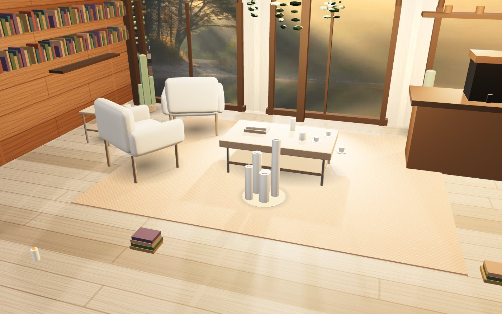
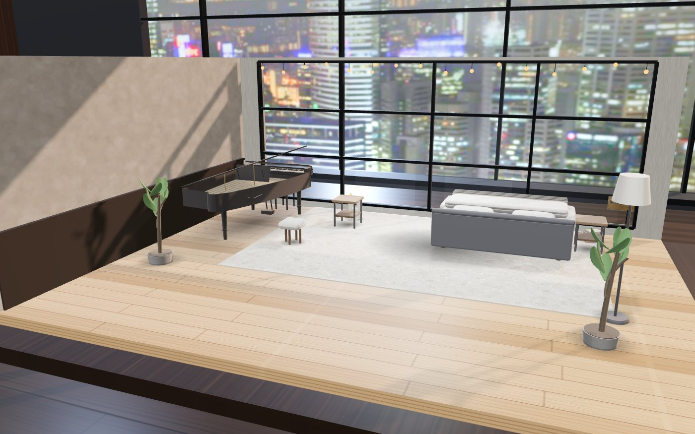
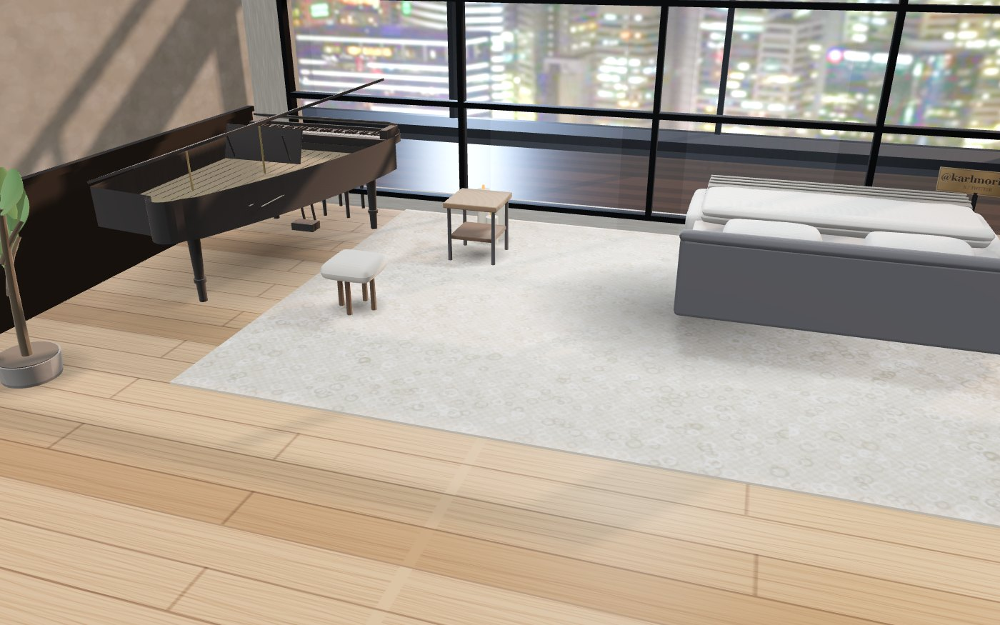
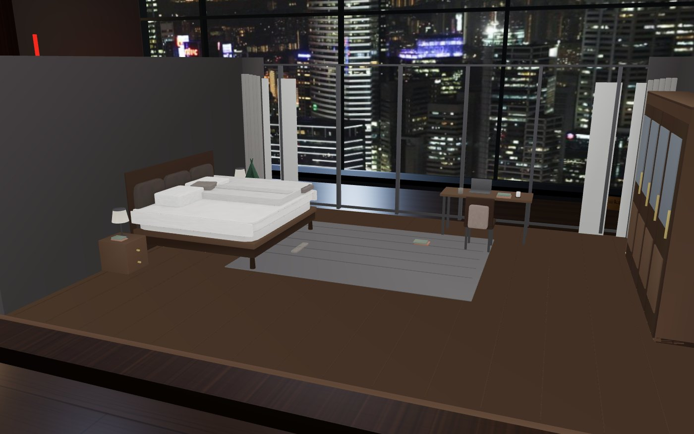
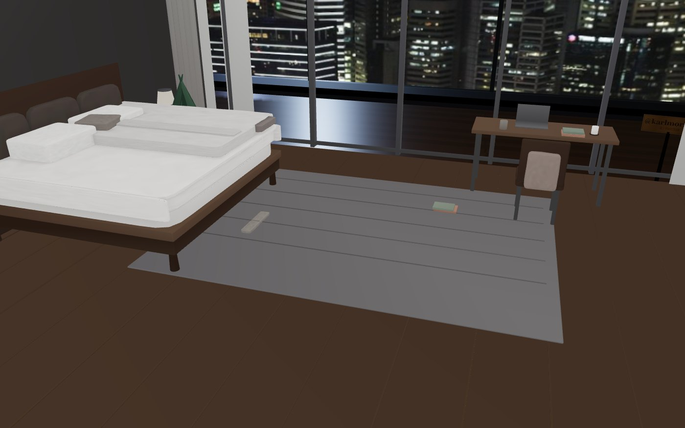

# 房间情绪板

**一间剖开的房间。把材质拖到墙上，把家具挪来挪去，拉一拉太阳。**

窗外的城市是真的，屋里的东西也是真的——四个房间全部用 Blender 建模，
不是贴图拼的。你能从任何角度转进去看，床腿、琴弦、门缝、抽屉把手都在。

---

## 四个房间

<table>
<tr>
<td width="50%"></td>
<td width="50%"></td>
</tr>
</table>

### 暖光客厅 · 18:36

黄昏的光从整面落地窗斜进来，把地毯烤成蜜色。弧形沙发靠左墙，
三角钢琴对着窗，地上散着几支点着的蜡烛。

暖光下木头的纹理最明显——想对比材料质感，先从这个房间开始。

---

<table>
<tr>
<td width="50%"></td>
<td width="50%"></td>
</tr>
</table>

### 咖啡小馆 · 17:24

午后偏晚，斜光穿过拱窗，在木地板上拉出一排长影。吧台、藤椅、
靠窗的高脚凳，桌上有半杯没喝完的咖啡。

这个房间不大，适合试家具密度——摆满之后“静”读数会掉得很快。

---

<table>
<tr>
<td width="50%"></td>
<td width="50%"></td>
</tr>
</table>

### 居家主卧 · 09:24

早上九点半，光还偏冷。床靠左墙，三角钢琴占了半间屋子，
窗边垂着串灯，地上铺着一张格子毯。

主卧里那架钢琴是单独的模型：梨形琴体、掀开的琴盖、琴弦、
踏板架、三条车木锥形腿——1 万多面，凑近看弦和键都在。

---

<table>
<tr>
<td width="50%"></td>
<td width="50%"></td>
</tr>
</table>

### 夜景公寓 · 21:12

整面玻璃幕墙，窗外是成片的写字楼。室内只留几盏暖光：
床头的布罩台灯、衣柜踢脚灯、书桌上一台亮着的笔记本。

床品是多层的——床单垂到地上，被子翻了一道边，床尾压着一条毯子，
枕头后面还塞了两个抱枕。想看清“布”和“盒子”的区别，看这张床。

---

## 怎么玩

**拖材质** —— 底部样本栏里有木材、石材、织物、涂料。
按住任意一块拖到墙上、地上、家具上，那一个面就换材质。

**搬家具** —— 家具面板里选一件，拖进房间。位置会自动避让，不会插进墙里。

**拉太阳** —— 左上角的时间滑块控制太阳方位角和高角度。
拖动的时候，窗外的天色、屋里的光斑、墙上的反光一起变。

**读三个数** —— 右上角实时显示：

| 读数 | 跟着什么变 |
|---|---|
| **暖** | 色温、木材占比、灯光色 |
| **亮** | 开窗面积、墙面反射率、太阳高度 |
| **静** | 家具密度、软装占比、色彩饱和度 |

---

## 跑起来

克隆仓库，双击 `standalone.html`。

单文件，把全部模型几何、贴图、代码都内联在里面了——
不需要起服务器，不需要联网，不需要装任何东西。

想在浏览器里看源码版：起一个静态服务器指向 `moodroom/`，
`index.html` 是入口（ES module 需要 HTTP 协议）。

---

## 怎么做的

**渲染**：Three.js，纯手写，零第三方运行时依赖。
所有几何体的明暗靠 Blender 烘的顶点色和 AO，不是实时阴影——
这样在低端设备上也能跑到 60 帧。

**建模**：Blender 脚本化建模（`blender/*.py`），每个构件都是参数化的，
改尺寸不用重新拉界面。四个房间的字面量加起来：

| 模型 | 面数 |
|---|---|
| 三角钢琴 | 10 884 |
| 居家主卧 | 25 000 |
| 夜景公寓 | 84 582 |
| 家具库（14 件） | 88 149 |

**材质**：项目里没有一张外部贴图。木纹、织物、石材、涂料的纹理
全部是 canvas 程序化生成的，所以整个项目能塞进一个 HTML 文件。

**窗外**：城市是从实拍的夜景照片里取的三档调色（黄昏 / 白天 / 夜晚），
按时钟连续插值。3D 场景里的建筑只是近景剪影，提供视差。

---

## 开发记录

做这个项目踩过的坑、每次改动的因果，都记在 [docs/DEVLOG.md](docs/DEVLOG.md)。

里面有一些花了很久才定位的问题，比如：

- 场景切换时旧房间不移除，导致雪林穿到别的房间窗外
- 渲染循环每帧重设 `visible`，把一次性隐藏设置冲掉
- Blender 导出 VEC4 顶点色，打包器按 3 分量读，整块几何变成彩虹色

---

*用 Claude Code + Sonnet 5 开发。模型全部自制，无第三方素材。*
